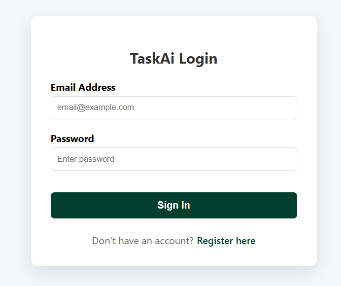
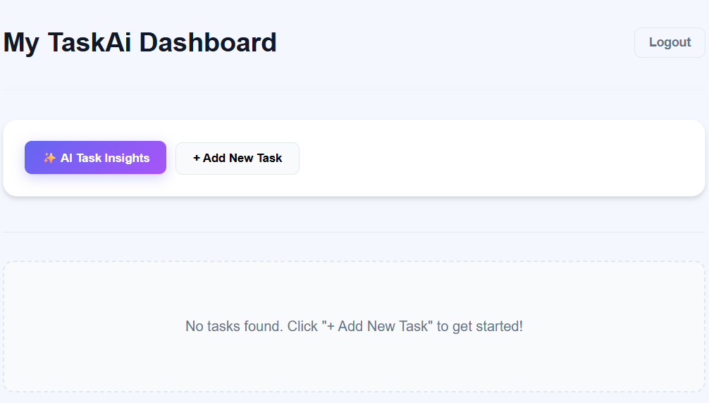
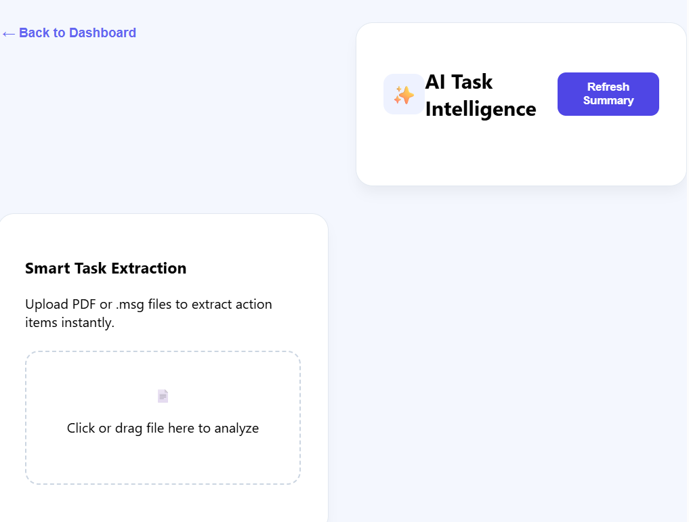

# TaskAi: Intelligent Task Management System

An AI-powered task management application built with **Angular 19** and **ASP.NET Core 9**. This project uses the **Gemini 2.5 Flash** model to provide conversational task summaries and automated task extraction from uploaded documents.

## 🌟 Key Features
* **AI Summary:** Generates a 3-sentence conversational status report of your current tasks.
* **Smart Extraction:** Automatically identifies tasks and due dates from uploaded PDF/Text files.
* **Task Management:** Full CRUD (Create, Read, Update, Delete) functionality with a PostgreSQL backend.
* **Responsive Design:** Clean, modern UI built with Angular.

## 📸 Screenshots

### Login page


### TaskAi Dashboard


### AI Task Insight


---

## 🛠️ Tech Stack
* **Frontend:** Angular 19, TypeScript, RxJS, CSS3.
* **Backend:** ASP.NET Core Web API, Entity Framework Core.
* **Database:** PostgreSQL.
* **AI Engine:** Google Gemini 2.5 Flash (via `Mscc.GenerativeAI` SDK).

---

## 🚀 Installation & Setup

### 1. Prerequisites
* Node.js (v18+)
* .NET 8/9 SDK
* PostgreSQL instance
* Google AI Studio API Key ([Get one here](https://aistudio.google.com/))

### 2. Backend Configuration
1.  Navigate to `Task-List-Backend/`.
2.  Create an `appsettings.json` file (refer to `appsettings.Example.json`).
3.  Add your PostgreSQL connection string and Gemini API Key:
    ```json
    "ConnectionStrings": {
      "DefaultConnection": "Host=localhost;Database=TaskDb;Username=postgres;Password=your_password"
    },
    "Gemini": {
      "ApiKey": "YOUR_ACTUAL_API_KEY"
    }
    ```
4.  Apply database migrations:
    ```bash
    dotnet ef database update
    ```
5.  Start the API:
    ```bash
    dotnet run
    ```

### 3. Frontend Configuration
1.  Navigate to `TaskAi-Frontend/`.
2.  Install dependencies:
    ```bash
    npm install
    ```
3.  Start the development server:
    ```bash
    ng serve
    ```
4.  Open `http://localhost:4200` in your browser.

---

## 🔐 Authentication Mechanism
The application uses **JWT (JSON Web Tokens)** for traditional authentication and supports **SSO (Single Sign-On)** integration. 
* **Why JWT?** It allows for stateless, secure communication between the Angular frontend and C# API.
* **SSO Management:** Users logging in via SSO are mapped to a `ProviderId` in the database to ensure a seamless experience regardless of the login method.

## 🤖 AI Assumptions & Limitations
* **Model:** Gemini 2.5 Flash was chosen for its high speed and generous free-tier quota.
* **File Support:** Currently supports `.pdf` and `.txt` files. 
* **Extraction:** Works best with documents containing clear dates (e.g., "Due on 2026-05-20").

---

## 📂 Database Schema
The schema includes:
* **Users Table:** Stores credentials, password hashes, and SSO provider details.
* **Tasks Table:** Stores task details with a foreign key relationship to the `Users` table.